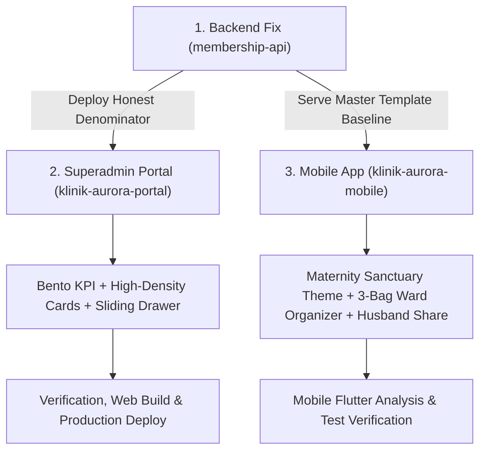

# Design Spec: Aurora Baby End-to-End Clinical & Maternity Sanctuary Overhaul

- **Date:** 2026-11-02
- **Target Repositories:**
  1. `membership-api` (Backend logic & Denominator Bug Fix)
  2. `klinik-aurora-portal` (Superadmin Executive Clinical Hub)
  3. `klinik-aurora-mobile` (Maternity Sanctuary Mobile Experience for Expecting Mums)
- **Status:** Approved / In Planning

---

## 1. Executive Vision: The 50+ Clinic CEO & 40-Year UI/UX Standard

### 1.1 The Maternal Healthcare Promise
Expectant mothers—especially first-time mothers—experience heightened vulnerability, cognitive fatigue, and anxiety fueled by predatory social media consumerism. They are told they need thousands of ringgit in baby gadgets, creating guilt and confusion.

**Klinik Aurora's core promise is reassurance, clinical authority, and calm.** The digital experience must feel like a trusted senior obstetrician and midwife sitting beside the mother with a warm cup of tea:
- Distinguishing **essential hospital labor ward items** from optional month-2 nursery goods.
- Eliminating cold corporate software palettes in favor of a soothing maternal sanctuary.
- Equipping fathers/partners with a 30-second "Labor Day Car Trunk" checklist when labor starts at 3 AM.

### 1.2 Core System Fixes & Scope
1. **Backend Denominator Bug**: Fix `baby-tracker.service.ts` so Beg Hospital readiness is measured against the active master template baseline (10 items), not user-synced subset rows.
2. **Superadmin Portal Overhaul**: Linear/Apple Health clinical executive cockpit with high-density patient cards, 40-week timeline scrubber, and sliding inspection drawer.
3. **Mobile App Maternity Transformation**: Warm rose-pearl aesthetic, 3-Bag Hospital Ward organizer, tactile haptic check-offs, husband WhatsApp summary dispatch, and progressive trimester journeys.

---

## 2. Backend Fix: Honest Baseline Denominator (`membership-api`)

### 2.1 Problem Diagnosis
In `admin/baby-tracker/baby-tracker.service.ts`:
```sql
SUM(CASE WHEN category_key = 'beg_hospital' THEN 1 ELSE 0 END) AS hospitalBagTotal,
SUM(CASE WHEN category_key = 'beg_hospital' AND is_checked = 1 THEN 1 ELSE 0 END) AS hospitalBagCompleted
```
Because the mobile app only inserts rows into `baby_checklist_item` when a user interacts with or syncs an item, a mother who has only touched 1 item has `hospitalBagTotal = 1`. If checked, 1/1 = 100%, falsely flagging patients as fully prepared for hospital admission.

### 2.2 Mathematical Fix
1. Query active master template count for hospital bag:
   ```sql
   SELECT COUNT(*) AS total
   FROM baby_checklist_template
   WHERE is_active = 1 AND (category_key = 'beg_hospital' OR is_hospital_bag = 1);
   ```
2. When evaluating patient checklist metrics:
   $$\text{hospitalBagTotal} = \max(\text{masterTemplateCount}, \text{userSyncedBagItems})$$
   $$\text{hospitalBagPercentage} = \text{round}\left(\frac{\text{hospitalBagCompleted}}{\text{hospitalBagTotal}} \times 100\right)$$
   A patient with 1 item completed will accurately show 1/10 = 10%.
3. Apply identical honest denominator logic to:
   - `admin/user-management/get-user-baby-checklist.ts`
   - `mobile/baby-checklist/get-checklist.ts`

---

## 3. Superadmin Portal UI/UX Overhaul (`klinik-aurora-portal`)

### 3.1 Visual Language & Palette
- **Surfaces**: Crisp Pearl `#FFFFFF`, Clinical Slate `#0F172A`, Subtle Border `#E2E8F0`.
- **Accents**: Clinical Teal (`#0F766E`), Maternity Rose (`#E11D48`), Amber Alert (`#D97706`).

### 3.2 Key Components
1. **Executive Bento KPI Stations**:
   - *Ibu Hamil Aktif*: Total count with live trimester badges (`T1`, `T2`, `T3`).
   - *Perhatian Klinikal (Urgent)*: Overdue pregnancies (>40w) + low kick alerts (<10 kicks at ≥28w) with 1-click filter.
   - *Kesiapsiagaan Beg Hospital*: Clinic-wide average readiness with true template denominator.
   - *Pemantauan Fetal Harian*: Real-time kick logging sessions count.
2. **Dual-View Patient Navigation**:
   - **Executive Patient Cards (Default)**:
     - 40-Week gestational timeline track with current position and trimester break indicators.
     - Fetal kick status badge (Pulsing green `≥10` vs Amber warning `<10`).
     - Beg hospital progress pill: `4/10 barangan • 40%`.
     - 1-click WhatsApp quick-chat + "Periksa Detail".
   - **Surgical Table**: High-density table for quick bulk scanning.
3. **Patient Deep-Dive Slide-Over Drawer**:
   - Edge-anchored smooth slide sheet (580px wide) replacing the clunky modal dialog.
   - Tab 1: Gestational Timeline & Profile.
   - Tab 2: Fetal Kick velocity logs & hourly distribution.
   - Tab 3: Categorized Checklist Accordion with live hospital bag validation.

---

## 4. Mobile App Experience Transformation (`klinik-aurora-mobile`)

### 4.1 Aesthetic: The Maternity Sanctuary
- **Goodbye Cold Obsidian**: Eliminate `#0F172A` / `#1E293B` dark terminal backgrounds.
- **New Warm Maternity Palette**:
  - Background: Alabaster Silk (`#FAFAF8`).
  - Hero Card: Gentle Rose Blush (`#FFF0F3`) to Warm Champagne Cream (`#FFF8F0`) gradient with soft rose-gold border (`#FDE2E8`).
  - Text & Accents: Warm Espresso `#292524`, Muted Mocha `#78716C`, Clinical Rose `#E11D48`, Calm Sage `#16A34A`.

### 4.2 Reassurance Hero Card (`AuroraBabyProgressSanctuaryCard`)
- Dual circular progress indicator:
  - Outer ring: Beg Hospital (Kritikal Wad).
  - Inner ring: Overall baby preparation.
- Dynamic Empathetic Micro-copy:
  - *Weeks 20–27*: "Awal lagi Mama. Rancang & kumpul senarai perlahan-lahan 🌸"
  - *Weeks 28–34*: "Masa ideal kemaskan Beg Hospital untuk wad bersalin 🏥"
  - *Weeks 35+*: "Bertenang Mama, bila-bila masa sahaja si manja akan tiba ✨"

### 4.3 Cognitive De-cluttering (No 55-Item Wall)
Replace infinite scrolling list with 3 purposeful pregnancy stages:
1. 🏥 **Beg Hospital (10 Barang Wad Bersalin - Prioriti Utama)**
   - Grouped into 3 intuitive sub-pouches:
     - **Beg Mama**: Kain batik, nursing bra, disposable panties, maternity pad, selipar wad.
     - **Beg Si Manja**: Baju butang depan, barut, bedung bayi, sarung tangan & stoking, lampin newborn.
     - **Dokumen Penting**: Buku Pink, Kad Pengenalan Suami & Isteri, Surat Jaminan / GL Insurans.
2. 🧸 **Persediaan Rumah & Bilik Bayi (Nursery & Pakaian)**
3. 🌿 **Keperluan Berpantang & Penyusuan Ibu**

### 4.4 Tactile Sensory Interactions
- Checking an item triggers `HapticFeedback.lightImpact()` with smooth spring-scale bounce.
- Strike-through animation with subtle celebratory burst.
- Reassuring confirmation: *"Satu lagi beban selesai, Mama."*

### 4.5 Partner / Husband Labor Room Co-pilot
- **1-Tap WhatsApp Dispatch Button**:
  - Formats checked and pending items into a clean, categorized message:
    *"Salam sayang, ini senarai beg hospital yang dah siap & belum untuk semakan dalam kereta:"*
  - Lets the husband verify the car trunk in 30 seconds at 3 AM.

### 4.6 Dr. Aurora Practical Midwife Wisdom Sheet
- Tapping any item opens the redesigned clinical wisdom sheet:
  - **Spesifikasi**: e.g., 100% cotton, butang depan (mudah skin-to-skin & rawatan jururawat).
  - **Peringatan Keselamatan**: e.g., elak bantal lembut berlebihan untuk elak risiko SIDS.
  - **Tip Jimat Bajet**: e.g., baju newborn pakai 2–3 minggu sahaja, jangan bazir beli berpuluh pasang.

---

## 5. Implementation Roadmap



---

## 6. Verification & Acceptance Criteria

1. **Backend**:
   - `hospitalBagPercentage` for a user with 1 checked item out of 10 master items strictly returns `10%`.
   - Clinic-wide `avgHospitalBagPercentage` calculates true average based on master baseline.
2. **Portal**:
   - `fvm flutter analyze` passes with 0 issues.
   - Dual-view toggle works smoothly.
   - Slide-over drawer opens seamlessly without full-page modal obstruction.
   - Production web build compiles cleanly with `fvm flutter build web --release` and deploys to Firebase Hosting.
3. **Mobile**:
   - `fvm flutter analyze` passes with 0 issues.
   - Warm Rose-Pearl sanctuary theme renders without dark/cold elements.
   - Beg Hospital 3-sub-pouch organizer displays cleanly.
   - Husband WhatsApp sharing correctly generates formatted message.
   - Haptic feedback and animations execute at 60fps.
